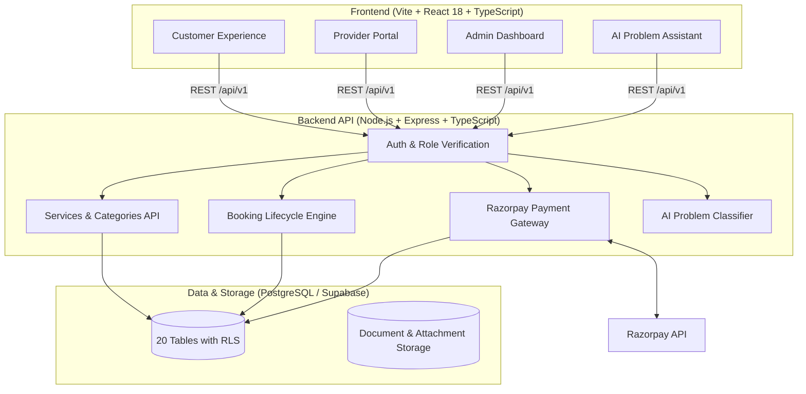

# FixNear — AI-Powered Home Services Booking Platform

<p align="center">
  
</p>

FixNear is a home services marketplace tailored for the Indian urban market (INR ₹, Asia/Kolkata). It pairs homeowners and tenants with verified independent tradespeople—electricians, plumbers, carpenters, AC technicians, cleaning crews, and appliance specialists—with transparent pricing, anti-double-booking slot guarantees, Razorpay test mode payments, and an AI diagnostic assistant.

---

## 🌟 Key Highlights

- **Target Market**: India (Standard currency: INR ₹, default launch hub: Bengaluru, Karnataka).
- **Core User Roles**:
  - **Customer**: Natural-language problem search, address management, scheduled arrival windows, transparent price breakdown (Base + ₹49 platform fee), Razorpay test/demo checkout, live booking status tracking, itemized tax invoice, reviews.
  - **Service Professional (Pro)**: Onboarding with Govt ID (Aadhaar/PAN) upload, incoming job alerts (Accept/Reject), live dispatch progress stepper (*On The Way* &rarr; *In Progress* &rarr; *Completed*), transparent 85% net earnings ledger.
  - **Administrator**: Ground-truth marketplace metrics (GMV, platform revenue, booking volume), provider verification queue with document viewer, tamper-evident audit logs.
- **AI Booking Engine**:
  - Natural-language symptom classifier ("Split AC running but blowing warm air").
  - Automated urgency assessment & clarifying diagnostic questions.
  - Semantic service catalog matching with zero hallucinated prices.
- **Payment Architecture**:
  - Server-calculated orders to prevent client-side price tampering.
  - Razorpay Test Gateway integration + cryptographic HMAC-SHA256 signature verification.
  - Webhook listener with idempotent delivery handling.
  - Built-in risk-free Demo Mode for student hackathons and portfolio evaluations.

---

## 🏗️ Architecture & Technology Stack



### Technology Matrix

| Layer | Technologies |
|---|---|
| **Frontend** | React 18, Vite, TypeScript, Tailwind CSS, Lucide Icons, React Router v6, TanStack Query |
| **Backend** | Node.js, Express, TypeScript, REST API (`/api/v1`), Zod, Helmet, Morgan, Express Rate Limit |
| **Database** | PostgreSQL, 20 Tables, 4 SQL Migrations, Row Level Security (RLS) policies, Pre-seeded data |
| **Payments** | Razorpay (Test Mode & HMAC signature verification) + Simulated Demo Mode |
| **AI Layer** | Configurable Google Gemini / OpenRouter provider + deterministic NLP classifier fallback |
| **Testing** | Vitest, Supertest, TypeScript type checking |
| **DevOps** | Docker, Docker Compose, GitHub Actions CI |

---

## 🚀 Quickstart & Local Development

### Prerequisites
- Node.js `v20.x` or `v24.x`
- npm `v10.x` or higher
- Git

### 1. Clone & Install
```bash
git clone https://github.com/your-username/fixnear.git
cd fixnear

# Install root, client, and server dependencies
npm install
```

### 2. Configure Environment Variables
Copy `.env.example` to `.env`:
```bash
cp .env.example .env
```
*(FixNear comes pre-configured with realistic seeded data and demo payment modes, so you can run it immediately without external keys!)*

### 3. Run Development Servers
```bash
npm run dev
```
- **Web App**: [http://localhost:5173](http://localhost:5173)
- **API Server**: [http://localhost:5000](http://localhost:5000)
- **Health Check**: [http://localhost:5000/health](http://localhost:5000/health)

### 🔐 Demo Credentials & RBAC Roles

FixNear comes pre-configured with secure bcrypt-hashed accounts for immediate testing:

| Role | Email | Password | Allowed Access |
|---|---|---|---|
| **Customer** | `rahul.sharma@example.com` | `Password@123` | Customer Dashboard (`/customer/dashboard`), Bookings, Addresses, Reviews |
| **Worker / Pro** | `ramesh.electrician@example.com` | `Password@123` | Provider Dashboard (`/provider/dashboard`), Job Workflow, Earnings Ledger |
| **Admin** | `admin@fixnear.in` | `Password@123` | Admin Dashboard (`/admin/dashboard`), Verification Queue, Metrics, Audit Logs |

*Note: Public registration allows new Customer and Worker accounts. Admin registration is strictly prohibited and can only be provisioned by authenticated administrators.*

---

## 🧪 Testing & Verification

Run the full automated test suite:
```bash
# Backend Vitest & Supertest Integration Suite
npm run test --workspace=server

# TypeScript Strict Typecheck
npm run lint --workspace=server

# Production Client Build
npm run build --workspace=client
```

---

## 🗄️ Database Schema & Supabase Migrations

All SQL migrations are organized in `supabase/migrations/`:
- `001_initial_schema.sql`: 20 relational tables (profiles, customer_addresses, provider_profiles, provider_documents, services, bookings, booking_status_history, payments, reviews, notifications, admin_audit_logs, etc.).
- `002_rls_policies.sql`: Strict Row Level Security policies guaranteeing customers only see their records, providers only see authorized job addresses, and admins access moderation.
- `003_indexes_and_triggers.sql`: Anti-double-booking partial unique indexes and automated updated_at / status history triggers.
- `004_seed_data.sql`: Seed dataset of Bengaluru electrical, plumbing, AC repair, carpentry, and deep cleaning services.

---

## 💳 Razorpay Test & Demo Mode Guide

1. To test real Razorpay Checkout popups:
   - Create a free Razorpay account at [dashboard.razorpay.com](https://dashboard.razorpay.com).
   - Generate test keys under *Settings &rarr; API Keys*.
   - Add `RAZORPAY_KEY_ID` and `RAZORPAY_KEY_SECRET` in your `.env`.
2. To test in **Demo Mode**:
   - Keep `ENABLE_DEMO_PAYMENT_MODE=true` in `.env`.
   - On the Customer Dashboard, click **"Pay (Demo Mode)"** to execute instant verification with authentic status updates without making real financial transactions.

---

## 🚢 Docker Deployment

Build and run using Docker Compose:
```bash
docker-compose up --build
```
- Client will be available at [http://localhost:5173](http://localhost:5173)
- Backend API will be available at [http://localhost:5000](http://localhost:5000)

---

## 📄 License
FixNear is open-source software licensed under the [MIT License](LICENSE).
