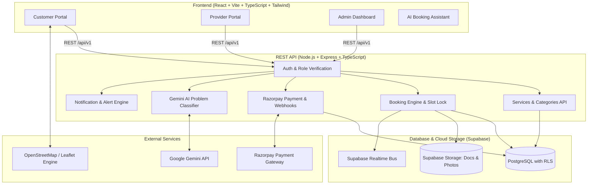
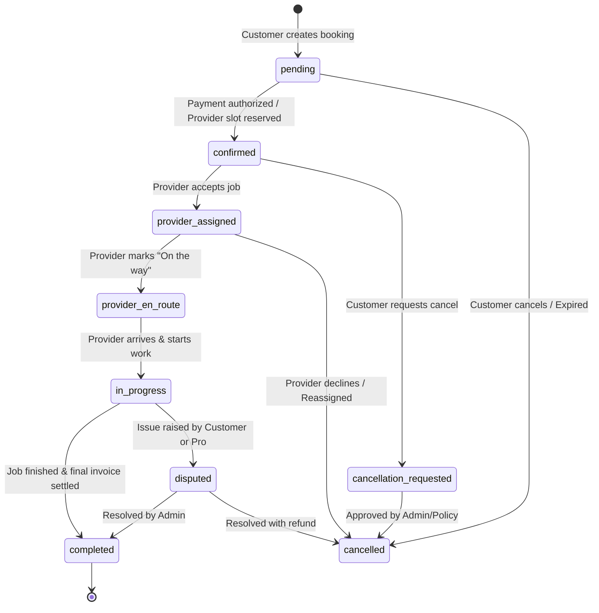

# FixNear Architecture & System Design Specification

## 1. System Overview
FixNear is a full-stack on-demand home services marketplace designed for the Indian market (currency: INR ₹, timezone: Asia/Kolkata). It facilitates seamless booking between homeowners/tenants ("Customers") and skilled tradespeople ("Providers" or "Pros"), managed through an "Administrator" portal.

---

## 2. Booking State Machine & Transaction Lifecycle

Every booking follows a strictly validated server-side state transition machine:

---

## 3. Database Schema Entity Relationship

1. **`profiles`**: User metadata, role (`customer`, `provider`, `admin`), phone, full name.
2. **`customer_addresses`**: Saved locations with coordinates (`lat`, `lng`), city, pincode.
3. **`provider_profiles`**: Pro skills, rating, verification status, service radius, commission rate.
4. **`provider_documents`**: Verification artifacts (Aadhaar, Govt ID, trade certificates).
5. **`service_categories`**: Electrician, Plumber, Carpenter, AC Service, Cleaning, Painting, etc.
6. **`services`**: Specific services with base price (INR), estimated duration, description.
7. **`provider_services`**: Many-to-many link between providers and specific services offered.
8. **`provider_availability`**: Daily recurring or scheduled working windows.
9. **`bookings`**: Central ledger with reference number, dates, status, pricing summary.
10. **`booking_status_history`**: Audit trail of all transitions with timestamps and actors.
11. **`booking_attachments`**: Customer photos of problem, completion photos.
12. **`booking_price_breakdowns`**: Itemized invoice (base, addons, taxes, platform fee, discount).
13. **`payments`**: Razorpay order ID, payment ID, signature, status, verification flag.
14. **`refunds`**: Detailed refund records linked to payment and cancellation.
15. **`provider_earnings`**: Net earnings per job after platform commission deduction.
16. **`provider_payouts`**: Payout tracking and bank settlement status.
17. **`reviews`**: 1 to 5 star ratings and written reviews from customers.
18. **`notifications`**: Persistent in-app notifications with unread states.
19. **`support_tickets`**: Customer and provider support tickets with priority and resolution.
20. **`admin_audit_logs`**: Tamper-evident admin action logging.
